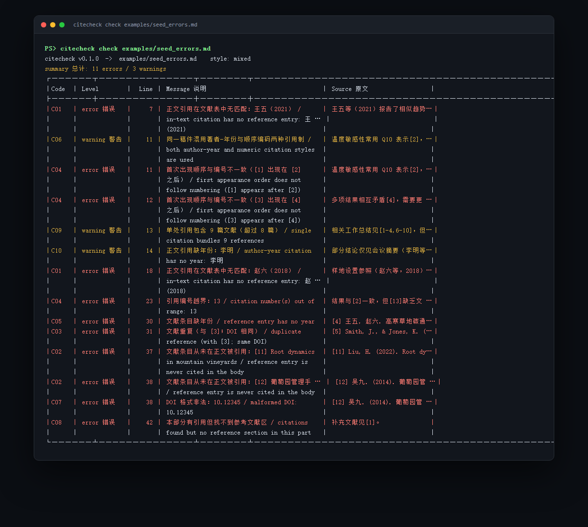

# citecheck-zh

**中文稿件引文—文献表一致性检查。** 在投稿前找出“正文引了但文献表没有、文献表有但正文没引、编号断档、重复条目、坏 DOI”这类结构性问题。

[](https://github.com/uppercrusteve/citecheck-zh/actions/workflows/ci.yml)
[](LICENSE)
[](pyproject.toml)
[](pyproject.toml)

## 实际运行



上图由 `citecheck check examples/seed_errors.md` 真实运行后截取：`examples/seed_errors.md` 是合成演示稿，故意埋入 10 类问题，输出为 11 errors / 3 warnings。

## 为什么做

中文投稿流程里，正文与文献表通常分开编辑：删改句子会留下悬空引用，补文献会打乱顺序编码，从 PDF 复制的 DOI 可能缺号或带尾标点。期刊编辑和审稿人反复指出这些问题，但人工逐条核对既慢又容易漏。通用文献管理器擅长“存文献”，不擅长“拿正文和文献表互相对照”。

citecheck-zh 只做结构核对：不判断文献质量，不联网，不调用大模型，规则和阈值都写在源码与 [docs/methods.md](docs/methods.md) 里。它适合作为投稿前的最后一道机械检查，而不是替代人工通读。

## 安装

需要 Python 3.10+（CI 覆盖 3.11/3.12）。运行时只依赖 `rich`。

Windows PowerShell：

```powershell
git clone https://github.com/uppercrusteve/citecheck-zh.git
cd citecheck-zh
py -3.12 -m venv .venv
.\.venv\Scripts\Activate.ps1
python -m pip install -e .
```

macOS / Linux：

```bash
git clone https://github.com/uppercrusteve/citecheck-zh.git
cd citecheck-zh
python3 -m venv .venv
source .venv/bin/activate
python -m pip install -e .
```

开发环境加测试依赖：`python -m pip install -e ".[dev]"`。安装后命令为 `citecheck`。

## 快速开始

```bash
citecheck check examples/seed_errors.md
citecheck check examples/clean.md --color never
citecheck init -o demo.md
```

第一条预期以退出码 `1` 结束，并列出 C01–C10 全部 10 类命中（共 14 条）；第二条打印 `未发现问题 / No issues found.`，退出码 `0`；第三条生成一份与截图同源的演示稿。把 `python -m citecheck_zh.cli` 当作 `citecheck` 也可以运行。

JSON 报告：

```bash
citecheck check examples/seed_errors.md --json
citecheck check examples/seed_errors.md --json -o report.json --force
```

重排编号（只改正文编号与文献顺序，不改条目内容）：

```bash
citecheck renumber examples/seed_errors.md --force
citecheck check seed_errors.renumbered.md --color never
```

`renumber` 默认输出 `<文件名>.renumbered.md`；上例中重排了 12 条文献、更新了 4 行正文，复查时 C04 的越界与顺序问题消失。

## 输入格式与输出

**输入**：UTF-8 的 Markdown 或 TXT（可带 BOM）。参考文献区标题写成 `参考文献`、`引用文献`、`References`、`Bibliography`、`Literature Cited` 或 `Works Cited` 的 Markdown 标题即可（也接受单独一行的无 `#` 标题）；该区在下一个同级或更高级标题处结束。条目可用 `[1]`、`［1］`、`1.`、`1)`、`1、` 编号，也可用 `-`/`*` 列表；续行会并入同一条目。

正文支持顺序编码引用 `[1]`、`[1,3]`、`[3-6]`（半角/全角括号均可，范围会展开）以及著者-年份引用 `（张三，2020）`、`张三等（2020）`、`Smith et al. (2019)`、`(Smith & Jones, 2019)`；同一括号内可用分号分隔多段。围栏代码块中的内容不扫描。

**输出**：终端表格（Code / Level / Line / Message / Source）或 JSON。JSON 字段为 `tool`、`version`、`file`、`style`、`summary` 与 `findings[]`；每条 finding 含 `code`、`level`、`line`、`column`、`message`、`message_zh`、`message_en`、`snippet`。行号、列号均从 1 开始，列号指向引用起始括号。

**退出码**：`0` 无错误（可有警告）；`1` 至少一条 error；`2` 输入/输出错误（文件不存在、非 UTF-8、目标已存在且未加 `--force`）。注意：`--json -o FILE` 在成功写入文件时返回 `0`，是否有错误以 JSON 的 `summary` 为准；输出到 stdout 时仍按 error 返回 `1`。`--min-level` 只控制显示，不改变退出码。

## 方法与局限

| 代码 | 级别 | 检查 |
|---|---|---|
| C01 | error | 正文著者-年份引用在文献表中无匹配 |
| C02 | error | 文献条目从未在正文被引用 |
| C03 | error | 重复条目（DOI 相同，或标题相似度 ≥ 0.90） |
| C04 | error | 引用编号越界、文献编号断档、首次出现顺序与编号不符 |
| C05 | error | 文献条目缺年份 |
| C06 | warning | 同一稿件混用两种引用制 |
| C07 | error | DOI 格式非法 |
| C08 | error | 引用所在部分找不到参考文献区 |
| C09 | warning | 单处引用捆绑超过 8 篇文献 |
| C10 | warning | 著者-年份引用缺年份 |

比较前会做 NFKC 全角/半角归一、空白折叠与小写化；姓名再做去标点比较，`等` 与 `et al.` 视为同一省略形式。全部 10 条规则的判定、行号定位、范围展开、重排算法、已知误报边界与局限见 **[docs/methods.md](docs/methods.md)**。

重要局限：只做结构与格式核对，不核对文献内容、作者顺序、期刊名或是否符合 GB/T 7714 / APA；不做 PDF/DOCX 解析；标题去重依赖 8 字符下限与 0.90 阈值，短标题可能漏报；中文姓名按 2–4 个汉字切分，复姓和机构作者可能误判；正文中普通圆括号若形似“姓名+年份”会被当成引用。

## 数据来源

`examples/clean.md` 与 `examples/seed_errors.md` 都是**合成演示**，为测试规则而编写，不是观测数据；人名、期刊卷页与 DOI 仅用于展示，未逐一验证 DOI 可解析。`citecheck init` 生成的内容与 `examples/seed_errors.md` 同源。除演示数据外，工具不附带语料，也不联网。

## 测试

```bash
python -m pip install -e ".[dev]"
ruff check .
pytest -q
```

当前 63 个测试全部通过，覆盖 10 条规则的正例与静默例、解析边界、全角括号、范围展开、`et al.`/`等`、重排与 CLI 退出码。CI 在 Ubuntu 与 Windows 的 Python 3.11/3.12 上运行同样命令。

## 引用

若在论文或工具链中使用，请按 [CITATION.cff](CITATION.cff) 引用：

```bibtex
@software{xiao_citecheck_zh_2026,
  author  = {Xiao, Yilong},
  title   = {citecheck-zh: Structural citation-reference consistency checker for Chinese manuscripts},
  year    = {2026},
  version = {0.1.0},
  license = {MIT},
  url     = {https://github.com/uppercrusteve/citecheck-zh}
}
```

## English summary

citecheck-zh is an offline, rule-based consistency checker for citation markers and reference lists in Chinese-language manuscripts. It parses UTF-8 Markdown/TXT, recognizes numeric and author-year citations, and reports structural defects with 1-based line and column positions. Ten rules cover unmatched citations, uncited entries, duplicates, numbering gaps/out-of-range numbers, missing years, mixed styles, malformed DOIs, missing reference sections, oversized citation bundles, and undated author-year citations. Output is a Rich terminal table or JSON; `renumber` rewrites numeric citations by first appearance. The only runtime dependency is `rich`; Python 3.10+ is required. Demo manuscripts are synthetic, and the checker validates structure rather than bibliographic content or a specific citation standard.

## License

MIT。见 [LICENSE](LICENSE)。版权行：Copyright (c) 2026 Yilong Xiao。
